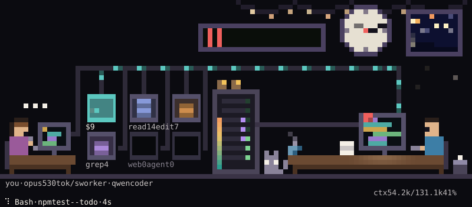
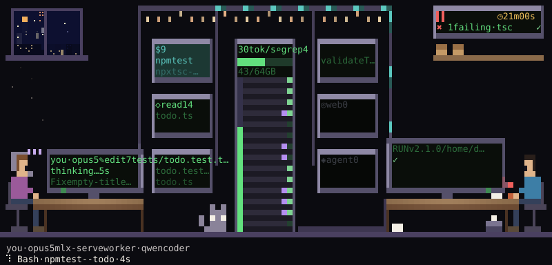
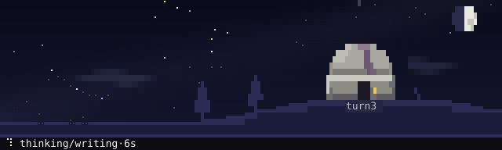
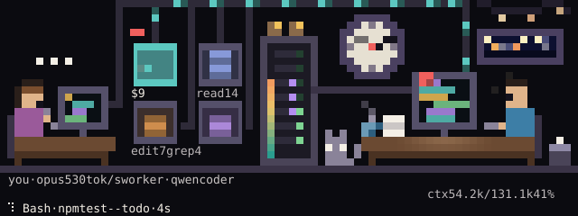

# lookout

**A little office beside your Claude Code session.** Claude works; the picture keeps up.



lookout is a free mod for Claude Code. You work with Claude in the main area as usual; lookout
is the sidebar beside it, showing what is going on. That can be the session you are talking to,
or a worker you handed a task to: typically a local model you are trying out, coding headless
under `claude -p` while you get on with something else. A glance tells you whether it is
working, stuck or done, without reading a log.

The pane draws the run as a small animated pixel scene. Each tool lights its own station. The
context window fills up. A failing test run turns the tally board red, and the fix earns a gold
star. A mug lands on the desk every ten turns, and the cat dozes when nothing moves. Under the
picture, in plain words: what Claude is doing, what it is thinking, and how the run is going.

There is nothing to set up: once installed, it follows the session it sits in.

## Install

At a Claude Code prompt:

```
/plugin install lookout --marketplace kpmfyi/lookout
```

From a shell, `claude plugin install lookout --marketplace kpmfyi/lookout` does the same. In the
desktop app: **+** next to the prompt box → **Plugins** → **Add marketplace** → `kpmfyi/lookout`.

You need Claude Code 2.1.312 or newer, and a terminal for the scenes. The desktop app, VS Code
and mobile show the same pane as text.

## Try it

| | |
|---|---|
| `/lookout` | open the pane; it says what it follows (this session, unless there is a worker) |
| `/lookout demo` | a scripted 72-second run through every state, with no worker and no model needed |
| `s` · `l` · `d` | in the pane: next scene · next layout · unfold the last diff and command output |
| `/lookout office-hd` | pick a scene by name |
| `/lookout ambient` | the scene alone, filling the pane; for a second monitor |
| `/lookout worker` | print the command that starts a worker on your local model server |
| `/lookout night` · `paper` · `phosphor` | palettes for dark terminals, light ones, and a green CRT |

## Three scenes

**office** (the default): your session as a room, sized for a sidebar. Tool stations along the
back wall light for read, edit, shell, search, web and agents; the model's rack hums in the
middle; Claude works at its desk. The window follows the season.
<br>

**office-hd**: the same office at four times the density. Claude's monitor shows the actual work
(the diff it just wrote, the output of the command it just ran) and a board keeps the test tally
and the commits.
<br>

**observatory**: a quiet sky for an ambient pane. The moon fills with the context window, each
turn adds a star, and every tool call falls as a shooting star in its tool's colour.
<br>

The scenes remember the run as well as showing the moment: the mugs, the paper stack, the bin of
crumpled errors and the tally of test runs only grow.

Around all that, a slow lofi layer keeps the room alive while you read: a city across the street
at night with a light going out now and then, rain running down the window in spring and autumn,
fireflies on summer nights, string lights along the ceiling, steam off the mug, the cat breathing
in its sleep. None of it means anything, so it
never draws over text or in a colour that reports the run. Set `ambience` to `off` for the plain
scenes.

## Calm, detailed, ambient

`l` walks three layouts:

- **calm** (the default): for watching, not debugging. The scene says what is happening in plain
  words ("running the tests", "your turn"), then the task, Claude's latest thinking with plenty of
  room, a few plain facts about the run so far ("12 minutes, 18 turns · changed 3 files · tests: 10
  of 11 passing") and, only when there is one, what is worth a look.
- **detailed**: the scene, a grid of instrument modules (counters, a context dial, a decode meter,
  an oscilloscope of turn pace, test lamps, a tape of recent tool calls), then every text block:
  thinking, checks, git, the result and a timeline. The last edit and the last command are one line
  each; `d` unfolds them into the diff and the output. From 70 columns the modules flank a large
  scene instead of sitting under it.
- **ambient**: the scene alone, filling the pane. On a tall pane office-hd becomes the showcase: the
  room at the bottom and its wall filled with screens: the thinking with problems in red, good news
  in green and names in cyan; instruments for the readings the room doesn't draw; a board of recent
  tool calls; and the last command.
<br>

## Watch a worker

Hand a task to a local model and watch it work from your normal session. From a clone of this
repository:

```sh
scripts/lookout-worker "Add due dates to todo items, with tests"
```

With the mod installed from the marketplace, `/lookout worker` prints the same command with the
installed script's path, ready to copy.

The script finds a running llama.cpp, Ollama, LM Studio, vLLM or mlx-serve server on its usual
port, picks the model it has loaded, writes the task to `logs/worker-current.handoff.md`, and runs
`claude -p` against the server's Anthropic Messages API into `logs/worker-current.jsonl`. The pane
follows that file on its own. The worker may edit files in the project and run tests, type checks
and read-only git; anything else it would have to ask for is denied, and the pane counts the
denials. Give the model 32k tokens of context or more (LM Studio: `lms load <model>
--context-length 32768`); flags after `--` go to `claude`. Tested end to end with LM Studio;
Ollama and llama.cpp were checked at the API endpoint, and vLLM and mlx-serve should work but are
untested so far. See
[docs/REFERENCE.md](docs/REFERENCE.md#watch-a-worker) for the details and the manual recipe.

The office gets a second desk, yours, which follows your own session while the worker works: a
sheet of paper slides across when you hand off a new task. The rack finds the model server by
itself and shows decode speed and memory.
<br>

The session you talk to can check on the worker as well: lookout registers a read-only
`mcp__lookout__status` tool that answers from the same summary the pane shows.

## Privacy

lookout only reads files. It never controls Claude or the worker, and it sends nothing off your
machine: the thinking is cleaned up and highlighted locally. The one exception is opt-in: turn on
`explain` and a small model says the thinking again in plain words (see
[docs/REFERENCE.md](docs/REFERENCE.md#thinking)). It is off by default.

## Limits

- The pane is a Claude Code mod, so it runs only inside Claude Code. Other CLIs can't host it;
  following their logs as workers is on the [roadmap](docs/ROADMAP.md).
- The scenes are drawn in the terminal only; other surfaces get the text pane.
- The cost is an estimate of what the run would cost on the API, and it says so.
- On Windows without a POSIX shell, logs over 4 MiB can't be followed: the mod reads files whole up
  to that size and reads further with `tail`.

## More

- [docs/REFERENCE.md](docs/REFERENCE.md): every block, module, setting and command; ambience,
  notifications, achievements, replay, the worker script, the model-server adapters and how the
  cost estimate is worked out.
- [docs/CONTRIBUTING.md](docs/CONTRIBUTING.md): how to build a scene, and how the code and tests are laid out.
- [docs/DESIGN.md](docs/DESIGN.md): the design log, decision by decision.
- [docs/ROADMAP.md](docs/ROADMAP.md): what might come next.
- [CHANGELOG.md](CHANGELOG.md): what changed in each release.

## Development

The scripts need Node 24 (it runs `.ts` directly); the mod itself needs nothing but Claude Code.

```sh
claude --plugin-dir /path/to/lookout   # load this folder as a mod
scripts/check.sh                        # every test and check
node scripts/render-scenes.ts           # redraw docs/images
```

## License

MIT. See [LICENSE](LICENSE).
