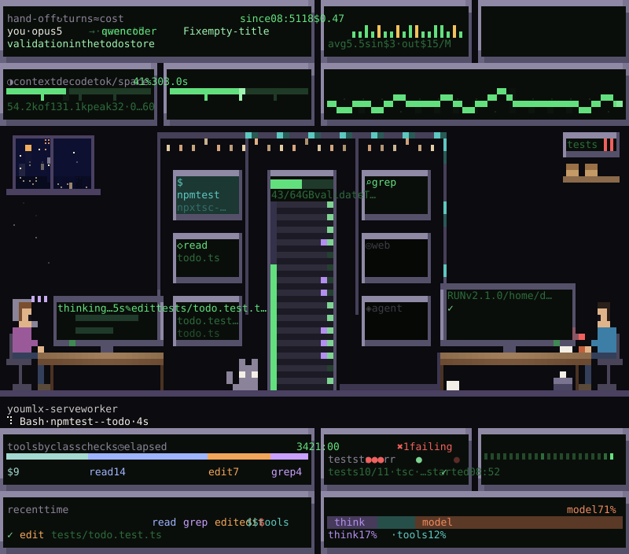
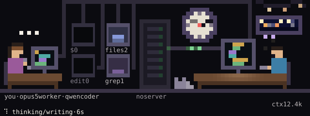
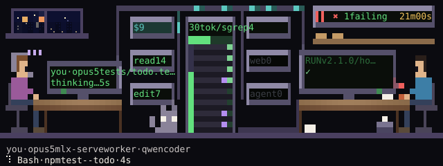
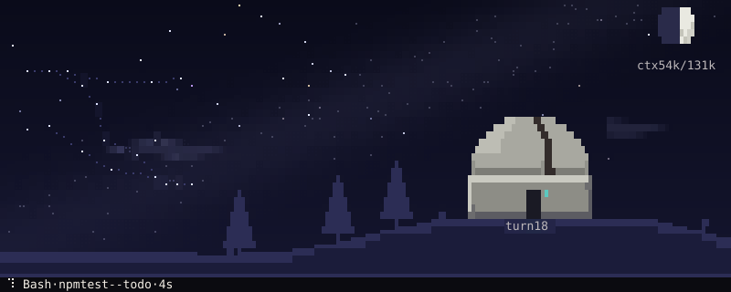
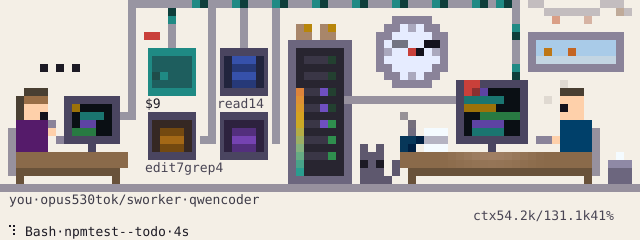
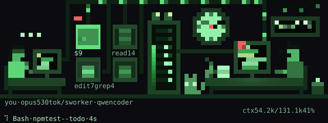

# lookout reference

Everything the [README](../README.md) leaves out: what each part of the pane shows, the commands
and keys, the layouts and modules, notifications, achievements, replay, the scenes and their
ambience in detail, palettes, the worker script, every setting, the model-server adapters, how the
cost estimate is worked out, and the known limits.

## What the pane follows

- **This session** (the default when there is no worker log): the session the pane sits in, read
  from its own transcript. The worker's desk is Claude's, named `claude`; there is no second desk.
  Between turns the pane says "your turn". The strip shows the latest prompt you typed. The cost is
  what the session would cost at its own model's API prices. `/lookout session` comes back to it.
  Until your first prompt the transcript does not exist yet, and the pane says so.
- **A worker**: any `claude -p --output-format stream-json --verbose` log, by path or by name (see
  [Configuration](#configuration)). `scripts/lookout-worker` starts one on a local model server and
  logs it where the pane looks (see [Watch a worker](#watch-a-worker)). The office gets your desk
  too, driven by this session.
- **The demo**: `/lookout demo`, a scripted 72-second loop through every state.

## What the pane shows

Top to bottom; anything with no data is left out.

- **Orchestrator strip**: `you · <your model> → worker · <worker model> · "<task>" · since 14:02`
  (the hand-off's time of day). The task is the handoff file's first non-empty line, else the
  worker's first message.
- **Scene**: the animated picture (terminal only); its last row is the status line and seconds.
- **Status**: thinking, running a tool (which, on what), reading the prompt, stalled, or finished.
- **Numbers**: turns, tool calls by kind, errors and denials, estimated output tokens, thinking time
  and the API cost estimate (`≈ $X at <model> (estimate)`). The output count is estimated from
  characters ÷ 4.
- **Time**: a ribbon of where the wall time went: thinking, running tools, and the rest (the model
  reading the prompt and writing).
- **Pace and context**: seconds per turn (median, p90) and the context size per turn against the
  window, when the limit is known.
- **Model server**: decode and prefill tok/s, the request in flight, KV-cache use, the context
  limit. Only for a local model, only while the run is live, and only what the adapter can read.
- **Memory**: free memory and the server's resident size (macOS and Linux).
- **Checks**: one mark per test run (vitest/jest, pytest, go test, cargo test, bun test, mocha) and
  `tsc` error counts, read from the worker's command output.
- **Git**: commits made in the worker's directory since it started, and uncommitted changes.
- **Result**: when the run ends, the result row's turns, wall and API time and token counts, the
  estimate at every model of `prices.json` and the **Runs** list (see [Runs](#runs)).
- **Thinking**: the latest thinking block (when the model emits one) and the latest reply.
- **Last edit**: the newest Edit/Write as a diff. **Last command**: the newest shell command and the
  tail of its output.
- **Timeline**: the recent tool calls, thinking and messages, with durations and errors.

These are the detailed layout's blocks; calm shows only its own (see [Layouts](#layouts)).

## Commands and keys

`/lookout <argument>`; names are not case-sensitive.

| command | does |
|---|---|
| `/lookout` | opens the pane and says what it follows |
| `/lookout demo` · `session` | plays the demo run · follows this session |
| `/lookout <path>` · `<name>` · `next` | follows a log by path, a named source, or the next of `sources` |
| `/lookout worker [task]` | prints the `scripts/lookout-worker` command to copy, with the installed script's path and `--server` and `--model` for the server the reader found; it runs nothing |
| `/lookout office` · `office-hd` · `observatory` | picks a scene |
| `/lookout calm` · `detailed` · `ambient` | picks a layout; `ambient` toggles, back to the layout you were in |
| `/lookout details` | unfolds or folds the last edit, the last command and the timeline |
| `/lookout compact` · `standard` · `large` | picks the scene's size for this session |
| `/lookout night` · `paper` · `phosphor` | picks a palette |
| `/lookout season [auto\|winter\|spring\|summer\|autumn\|none]` | says or picks what the office window shows |
| `/lookout replay [<path>\|<name>]` | replays the followed log, or another (see [Replay](#replay)) |

In the pane: `s` next scene, `l` next layout, `d` details (detailed layout), `n` next source (when
`sources` names any); while replaying `p`, `b`, `f`, `x` and `r`. A reloaded session keeps the
followed log and every pick.

## Thinking

The thinking is shown two ways, everywhere it appears (calm's thinking block, the detailed layout's
Thinking block, the showcase's thinking screen):

- **The gist**, always, worked out locally: the newest sentences that fit, with markdown, code
  blocks, line numbers, long paths and filler ("Hmm. Okay,") taken out, and a few words coloured:
  problems red, good news green, doubts amber, names cyan, decisions bold.
- **In plain words**, only when you turn it on: one to three short sentences a non-programmer can
  follow, from a small model (Haiku) through the session's own API client, labelled `in plain
  words` and never passed off as the model's own text. At most one request every 15 seconds, only
  when the thinking changed and is on show, never in replay. The `explain` setting: `off` (the
  default) never asks, so nothing leaves your machine; `session` asks for this session's thinking,
  which came from the API in the first place; `all` asks for workers too, whose thinking (a local
  model's included) then leaves your machine. The demo shows canned plain words whatever the
  setting, and asks nothing.

## Layouts

Three ways to arrange the pane, from quiet to dense; `l` walks them in this order, `/lookout calm`
(`detailed`, `ambient`) or the `layout` setting picks one. A reloaded session keeps the pick.

- **calm** (the default): for watching, not debugging, in plain words. The scene's caption says
  what is happening ("running the tests", "your turn"); under it come the task (`You asked: "…"` or
  `Working on: "…"`), the latest thinking with up to 12 lines (titled with its age; the latest reply
  when the model sends no thinking), **so far**: up to three plain facts ("12 minutes, 18 turns",
  "tests: 10 of 11 passing", "changed 3 files"), and **worth a look**, only when something is:
  failing tests, type errors, tool calls that failed or were blocked in the last five minutes, a
  context window nearly full. When the run ends one sentence says how it went. No numbers row,
  checks, git, timeline, diff or command output.
- **detailed**: the scene, a grid of instrument modules (counters, a context dial, a decode meter,
  an oscilloscope of turn pace, lamps for test runs, a clock, a tape of the recent tool calls…),
  then the thinking, the dashboard blocks, checks, git, the result, the timeline, and last the last
  edit and the last command. The modules stand in for the numbers, time, pace, model server,
  memory, checks and git blocks. The pane picks the arrangement by its width: under 70 columns the
  scene is drawn compact with the grid under it; from 70 columns the modules split in two and
  flank a large scene (the wall).
- **ambient**: the scene alone, for a second monitor or a pane you glance at. It fills the pane's
  height, with its own caption row (in plain words, as in calm) and the hotkey row under it.
  `/lookout ambient` toggles it and returns to the layout you were in. **The showcase**: drawn taller
  than its large size, office-hd keeps its large room at the bottom and fills the wall above with
  screens, in the order of what they are worth: the thinking screen (the plain words, then the
  highlighted gist, taking any spare rows), a row of instruments for the readings the room does not
  draw (turns, context, pace, where the time went, cost), a departures board of recent tool calls,
  and on very tall panes the last command's output.

**Details (`d`).** In detailed the last edit and the last command are one line each
(`Last edit 14:02 · todo.ts · +12 −3`, `Last command 14:03 · npm test · exit 1`) and the timeline
shows its newest 6 rows. `d` (or `/lookout details`) unfolds them into the diff, the output's tail
and a long timeline; `d` again folds them. A reload keeps the pick.

Off the terminal there is no scene: calm draws as itself (starting with the Now sentence), and
detailed and ambient draw the text blocks with a stats row in place of the modules.



**One home per fact.** In detailed each reading is spelled out once. A module that shows a
reading takes it out of the pane's own rows: with the `strip` module the strip row goes; the stats
row under the scene drops the turns, context, errors or cost a module shows (and goes when nothing
is left), and the header its model or elapsed. The scene drops its labels for those readings too
and keeps the picture (a station still lights, it just loses its count). The current tool and its
seconds have one home, the scene's caption.

The grid has 2 columns under 70 cells, 3 under 100, 4 under 130 and 5 beyond. The modules move
only when their reading does, and **a module with no data is hidden** (no model server: no decode
meter; no test runs yet: no lamps lit). The detailed layout draws the scene compact under 70
columns and large from 70 unless you set `sceneSize` or ran `/lookout compact|standard|large`;
ambient always draws it large or taller.

The `modules` setting lists the modules in order; empty means the default order
`strip, counter:turns, counter:cost, dial:ctx, vu:decode, scope:pace, ledmatrix, lamps, clock,
reels, river` (no `counter:tools`: the ledmatrix shows the same counts by class). Unknown ids are
skipped (a list of only unknown ids falls back to the default). Every id:

| id | shows |
|---|---|
| `strip` | you → worker, the task and the hand-off's time of day (`since 14:02`) |
| `counter:turns`, `counter:tools`, `counter:errors`, `counter:cost`, `counter:out` | turns (the average turn, and the last unless `scope:pace` shows it), tool calls, errors and denials, the ≈ cost estimate, estimated output tokens |
| `dial:ctx`, `dial:memory` | context used against the limit; memory used (needle, red past 80 %) |
| `vu:decode`, `vu:prefill` | model-server decode or prefill tok/s with a peak-hold tick |
| `scope:pace`, `scope:ctx` | seconds per turn, or context per turn, as an oscilloscope trace |
| `ledmatrix` | tool calls by class, the active class blinking |
| `reels` | the worker's model and a tape of its recent tool calls that runs while the model works |
| `patchbay` | orchestrator ↔ worker ↔ server ↔ tools, a cable to the busy jack |
| `clock` | elapsed time |
| `lamps` | test runs, type-checks, errors and denials, newest right |
| `toggles` | the pane's picks: the details fold, scene, size, palette (when there is room), source |
| `river` | where the time went: thinking, tools, the model (the largest share as its headline) |

## Notifications

The `notify` setting: `toasts` (default), `status`, `both` or `off`. Three events, each raised once:

- a test run with failures: `✖ worker: 2 of 12 tests failing`;
- the worker stalling (`⏸ worker: no log movement for 3m`) and resuming (`▶ worker resumed`);
- the run finishing: `✓ worker finished: success · 42 turns · 21m`, or `✖ worker finished: error_max_turns`.

`worker` stands for the log's name: its file name without `.jsonl` and `-current`
(`logs/worker-current.jsonl` is `worker`).
`toasts` shows them as toasts; `status` instead keeps one line under the prompt with what the
worker does now (`lookout · Bash npm test · 4s · ctx 41%`), cleared when no log is followed;
`both` does both. Nothing is raised for the first poll after switching logs (opening the pane on a
run that already failed its tests stays quiet), for the demo, or during a replay.

## Achievements

A few milestones, earned once per user and kept in the plugin's own store across sessions and
projects. When a followed run finishes, each new one is toasted once (with `notify` `toasts` or
`both`; `off` and `status` keep them quiet), and the run's **Result** block lists what it earned,
one `🏆` line each.

| achievement | earned by |
|---|---|
| 🏆 first light | the first finished run |
| 🏆 green | a run ending with its last test run passing and no errors |
| 🏆 marathon | a run over an hour |
| 🏆 centurion | 100 tool calls in one run |
| 🏆 night shift | a run finishing between midnight and 5 am, local time |
| 🏆 clean hands | no denials in a run of 20 or more tool calls |
| 🏆 frugal | a run under $0.10 at the `compare` price |
| 🏆 handoff | the first run with a handoff file |

The demo and replays never earn any.

## Replay

`/lookout replay` replays the followed log from its first row at ×8; `/lookout replay <path>` or
`/lookout replay <name>` replays another. The pane draws the log as it stood at the replay clock,
scenes included, with a dim row under the scene: `⏵ replay ×8 · 12m34s / 21m00s` (elapsed, then the
run's wall time once its result row is known), `⏸` while paused and `⏹ replay ended` at the end.
Hotkeys while replaying, shown as buttons only then: `p` pause/resume, `b` back 30 s, `f` forward
30 s, `x` speed (×1, ×4, ×8, ×32), `r` back to the live log. Any other `/lookout <source>` also ends
it. Replay never notifies and never adds to `runs.jsonl`.

## Runs

When a log has a result row, the log reader appends one line to `runs.jsonl` beside the log's real
path (through a `*-current.jsonl` symlink, the run's own file's directory): when, model, result,
turns, wall time, peak context, the last test run, errors and denials, and the estimate at every
model of `prices.json`. Once per run; never in replay.

When the run is done the **Result** block shows that estimate at every model, one line each, the
`compare` model in bold, then `priced <date> · estimate`, and under **Runs** the last 8 lines of
`runs.jsonl`, newest first: `hh:mm · model · result · turns · wall · ≈ $X at <compare>`, the run on
screen marked `▶`. The file is read at most every 10 s. With `compare` `off` no money is shown.

## Scenes

Three scenes; `s` cycles them, `/lookout <scene>` or the `scene` setting picks one. Each shows the
worker's state; pulses (tests, errors, commits) last 8 seconds and never change the state.

**Run memory.** The two offices remember the run, not only what is happening now, and they agree
on how to draw it: a coffee mug per 10 turns, a paper stack that grows with the edits, crumpled
paper in a bin for errors and denials, red sticky notes on the worker's monitor for failing tests,
a tally board of the last test runs with a gold star once tests go from red to green (and the
worker cheering for a while after), parcels for commits, and at the end a printed slip carried
back to your desk with a green or red stamp. Each appears once it has something to show.

**Only what the rest of the pane doesn't say.** A scene spells out a reading only when nothing
else in the pane does (see [one home per fact](#layouts)): beside the modules it drops its counts
and readouts and keeps the pictures, and its caption is the one place for the current tool and its
seconds.

**office** (10 / 15 / 22 rows, 48+ columns): you at your desk on the left, the tool stations and
the model server's rack in the middle, the worker at its desk on the right facing them, a ceiling
cable tray between them and packets travelling the cables for whatever is happening now. lookout
watches the session showing the pane, so your desk follows your own thinking and tools, and a
paper sheet slides to the worker's desk when it picks up a new hand-off file. A wall clock tells
the local time; the window follows the season. The large size gives the back wall room for the
test tally beside the clock and the window. Following this session, the room has one desk,
Claude's.
<br>

**office-hd** (10 / 15 / 24 rows, 60+ columns): the office at four times the density. You and
the worker face each other across a wall of tool-station panels flanking the model server's rack.
The worker's monitor shows the work: the last diff's lines while it edits, the last command's
output while it runs commands; your monitor shows the hand-off you gave it. The board in the top
right carries the test tally, the star after a red → green flip and the commit parcels; a cat
sits on the floor by the rack. Following this session, your desk gives way to a tall window with
a plant under it. Taller than its large size it becomes the showcase (see [Layouts](#layouts)).
<br>

**observatory** (7 / 12 / 20 rows): a domed observatory on a hill under a night sky. The moon
fills with the context window, each turn adds a star to a constellation, the dome's slit sweeps
while the model thinks, and every tool call falls as a shooting star in its tool's colour.
<br>

| | office | office-hd | observatory |
|---|---|---|---|
| thinking | code scrolls on the monitor | the worker thinks, the rack's lights blink with the decode speed | dome slit sweeps and glows |
| reading prompt | amber packets run to the rack | amber packets run to the rack, its bars amber | slit sweeps faster |
| tool | that tool's station lights | that tool's panel lights; the monitor shows the diff or the output | slit stops, door lamp in the tool's colour |
| stalled | agent leans back, coffee steams, monitor dims | the room dims, coffee steams, an amber caption | clouds cover the upper sky, slit closed |
| finished | lights off, monitor ✓/✖ | lights down, the slip comes back stamped ✓/✖ | dawn ✓, or night and a red lamp ✖ |
| tests pass | confetti falls | confetti falls from the ceiling | an aurora band |
| tests fail | last test light flashes red, red lines on the monitor | last tally mark and the monitor bezels flash red | a cloud bank drifts over the dome |
| error / denied | red lamp on the rack | the newest crumple in the bin flashes red | door lamp blinks red |
| commit | a parcel on the rack | a parcel on the shelf under the board | gold satellite |

Narrow panes (under 60 columns) drop labels and some stations; wide ones (100+) add detail.
office-hd below 60 columns draws its 60-column room cut at the right. By default the offices leave
their background unpainted so the pane matches your terminal's colour; set `background` to `scene`
for painted walls and floors (the observatory always paints its sky).

**Sizes.** Each scene has a `compact`, `standard` and `large` height (office 10 / 15 / 22 rows,
office-hd 10 / 15 / 24, observatory 7 / 12 / 20). Set the default with `sceneSize`, or switch for
this session with `/lookout compact|standard|large` (a reload of the mod keeps that pick, and a
picked size wins over a layout's own). A large scene is laid out again, not stretched: more sky,
taller objects. Observatory, large:
<br>

**How the scenes are drawn.** Every scene is terminal glyphs. office-hd and observatory use a
high-resolution canvas: each cell is a 2 × 4 grid of sub-pixels, drawn with quadrant, block and
braille characters in two colours per cell. Ghostty, kitty, iTerm2, WezTerm and Alacritty draw
these from built-in sprites, so they join without gaps; other terminals use the font's glyphs.
office uses half blocks (two pixels per cell).

## Ambience

A slow decorative layer in every scene, on by default; `ambience: off` draws the scenes without
it. It is there so a calm room never looks frozen while you read, and it is built so it can never
be mistaken for the motion that reports the run.

**The pieces**, each only where its scene has room for it (the compact size keeps the cat, the
steam and the lights at most):

- **The window at night** (both offices): a low skyline across the bottom of the glass with a few
  windows lit warm, one switching off or on every 20 to 40 seconds, and a plane light blinking
  across the top of the sky about every 90 seconds. By day and in light palettes the skyline is a
  pale silhouette with no lights.
- **Weather on the glass**: in spring and autumn a few raindrops run slowly down with short fading
  trails; summer nights get two or three dim fireflies instead; winter keeps its snow.
- **Dust in the light**: by day, a few faint motes drift under the window.
- **String lights**: warm bulbs breathing out of step, along the top of the wall (office) or under
  the ceiling tray (office-hd). Not during the `lights` holiday, which hangs its own on the window.
- **Lamplight**: a warm pool on the desk under the monitor (office: the worker's desk; office-hd:
  each desk), breathing over about eight seconds.
- **Steam**: a slow curl off the newest mug, in every state.
- **The cat**: asleep, its back rises and falls about every four seconds and an ear twitches now
  and then; sitting, it blinks slowly.
- **office-hd only**: the plant by the window sways (when the room has one desk), and a faint scan
  band drifts down screen rows that carry no text.
- **observatory**: thin clouds drift across the low sky, a minute to cross; grass at the horizon
  sways; the dome's slit breathes a faint warm light (the compact banner keeps the slit alone).

**The rules**, each held by a test where it can be:

- **Never over text.** Ambience touches art cells only; a cell with a letter, digit, glyph or
  caption is the same with ambience on and off.
- **Never in a meaning colour.** Nothing ambient is drawn in the palette's bad, good, warning or
  thinking colours, so a drip is never read as an error or a glow as a test passing. It has its own
  muted tones per palette (paper: soft shadows; phosphor: dim greens).
- **Slow and small.** Loops run 2 to 60 seconds; nothing blinks faster than twice a second; a
  breathing light changes by 15 % at most; a moving speck is one sub-pixel. Loops of different
  lengths overlap, so the picture does not repeat for minutes.
- **No new signals.** No red lights, no flashing, nothing that starts or stops with the run: it
  runs the same while thinking, during tool calls, on your turn and when done.
- **Pure.** A function of the frame counter and the clock, so the tests and the rendered images
  stay reproducible.

**Frame rate.** While the run is live the pane ticks every 120 ms either way. When it is done,
the scene repaints about four times a second with ambience on, so the loops do not stutter, and
once a second with it off. Frames whose cells did not change are not repainted.

## Palettes

Every scene and module paints from one of three palettes, picked
with the `palette` setting (default `night`) or switched live with `/lookout night|paper|phosphor`
(a reload of the mod keeps the pick). `night` is the look shown everywhere above, for dark
terminals. `paper` is for light terminals: light walls and floors, dark ink, meaning colours
darkened to read on a light background, while monitors, instrument screens and night skies stay
dark, as real screens do in daylight. `phosphor` is a one-colour green CRT; only failures stay red.
The office in `paper` and in `phosphor`:
<br>
<br>

## Watch a worker

`scripts/lookout-worker` hands a task to a headless Claude Code worker on a local model server and
logs it where the pane looks. It is POSIX sh and needs only `claude` and `curl`. From a clone, run
it as `scripts/lookout-worker`; with the mod installed from the marketplace, `/lookout worker`
prints the command with the installed script's path, and `--server` and `--model` for the server
the reader found (with none, how to start one). lookout itself never starts anything: the script
is something you run.

```
lookout-worker [--server NAME|URL] [--model NAME] [--dir PROJECT] [--dry-run]
               ("the task" | -f task.md) [-- claude args...]
```

| option | |
|---|---|
| `--server` | `ollama`, `llama.cpp`, `lmstudio`, `mlx-serve`, `vllm`, or a base URL. Default: probe ports 8080, 8000, 11434 and 1234 and take the first server that answers and can take the worker |
| `--model` | the model name to ask for. Default: the server's loaded model |
| `--dir` | the project to work in. Default: the current directory |
| `--dry-run` | print the environment and the command instead of running them |
| `-f FILE` | read the task from a file |
| `--` | pass the rest to `claude`, e.g. `-- --max-turns 40 --permission-mode auto`; a repeated flag wins |

**What it does.** It finds the server, checks that it serves the Anthropic Messages API
(`POST /v1/messages`), picks the model, moves a previous `logs/worker-current.jsonl` and its hand-off
aside to `logs/worker-<timestamp>.*` so no run is lost, writes the task to
`logs/worker-current.handoff.md`, and runs `claude -p --output-format stream-json --verbose` in the
project with its output in `logs/worker-current.jsonl`, which the pane follows on its own. Every
model role (main, small and fast, subagents, the opus/sonnet/haiku/fable aliases) points at the one
local model. Your own `ANTHROPIC_API_KEY` and the Bedrock, Vertex and Foundry switches are left out
of the worker's environment, so a key never goes to the local server and the run never leaves your
machine. It prints what it is doing; Ctrl-C stops the worker.

**Permissions.** Under `claude -p` nobody is there to answer a prompt, so anything that would ask
is denied, and the pane counts the denials. The default is `--permission-mode acceptEdits` (reads,
edits and new files inside the project, and plain file commands such as `mkdir`, `mv` and `rm`
there) plus an allowlist of the usual test runners, type checks and read-only git: `npm test`,
`npm run test`, `npx vitest`, `npx jest`, `npx tsc`, `pnpm test`, `yarn test`, `bun test`,
`pytest`, `python -m pytest`, `go test`, `go vet`, `cargo test`, `cargo check`, `make test`, and
`git status`, `git diff`, `git log`, `git show`. Installs, scripts, `curl`, `git commit` and
`git push` are denied. `LOOKOUT_WORKER_ALLOW='Bash(make check *),Bash(git diff *)'` replaces the
allowlist (empty: none); `-- --permission-mode auto` or `-- --dangerously-skip-permissions` widens
it.

**Context.** Claude Code's own prompt and tools take about 20k tokens, so give the model 32k or
more; the script warns when the server reports less, and tells Claude Code the server's window so
it compacts against it. A local model can take minutes to read that prompt the first time, so
`API_TIMEOUT_MS` defaults to 30 minutes.

**Environment**: `LOOKOUT_WORKER_TOKEN` (the bearer token sent to the server, `local` unless set),
`LOOKOUT_WORKER_ALLOW` (above), `CLAUDE` (the `claude` binary), `LOOKOUT_WORKER_URLS`
(space-separated base URLs to probe instead of the default ports).

| server | port | where the model comes from | start it with | status |
|---|---|---|---|---|
| LM Studio | 1234 | an already loaded model (`/api/v0/models`; its `/v1/models` lists every download and would load one on demand) | `lms server start; lms load <model> --context-length 32768` | verified end to end |
| Ollama | 11434 | the loaded model (`/api/ps`), else the first pulled one, loaded on the first request | `OLLAMA_CONTEXT_LENGTH=65536 ollama serve` | `/v1/messages` verified; newer versions only. The default context can be smaller than Claude Code's prompt |
| llama.cpp | 8080 | the one it serves (`/v1/models`) | `llama-server -m model.gguf -c 65536 --jinja` | `/v1/messages` verified; tools need a chat template with tool calls (`--jinja`) |
| vLLM | 8000 | the first in `/v1/models` | `vllm serve <model>` | should work, not yet verified; newer versions only, and tool calls need `--enable-auto-tool-choice` and a `--tool-call-parser` |
| mlx-serve | 8080 | the first in `/v1/models` | `mlx-serve --model <model>` | should work, not yet verified; per-request speeds in the pane need `serverLog` |

**By hand.** The script is a convenience; any stream-json log works. The same run without it
(`--dry-run` prints the exact environment it would use):

```sh
mkdir -p logs
echo "Add due dates to todo items, with tests" > logs/worker-current.handoff.md
env -u ANTHROPIC_API_KEY \
  ANTHROPIC_BASE_URL=http://127.0.0.1:1234 ANTHROPIC_AUTH_TOKEN=local \
  ANTHROPIC_MODEL=<model> ANTHROPIC_SMALL_FAST_MODEL=<model> CLAUDE_CODE_SUBAGENT_MODEL=<model> \
  claude -p --model <model> --permission-mode acceptEdits \
    --output-format stream-json --verbose \
    < logs/worker-current.handoff.md > logs/worker-current.jsonl
```

With `./logs/worker-current.jsonl` in the project the pane follows it rather than the session;
`/lookout <path>` follows any other log.

## Let your orchestrator check the worker

lookout registers a read-only tool, `mcp__lookout__status`, so the model you talk to can check the
worker it handed work to without reading the log. It answers from the summary the pane shows;
`detail: "full"` adds the last 10 timeline rows, the last edit and the last command's output, and
`source` names another source or log path (the pane keeps following its own). It never controls
the worker. Turn it off with the `tool` setting. A brief answer:

```
lookout · worker · local/qwen-coder-32b-q4 · following logs/worker-current.jsonl
state: running Bash "npm test -- todo" for 4s · turn 18 · ctx 54.2k/131.1k (41%) · 21m00s elapsed
tests: last run 10/11 passed, 1 failing (1m40s ago) · tsc clean · errors 1 · denials 0
last error: Bash (1m40s ago): "npm test: exit code 1"
git: fix/empty-title · 2 commits since start · 2 files dirty · 1 untracked
server: mlx-serve 30 tok/s decode · 805 tok/s prefill
cost: ≈ $0.47 at claude-sonnet-5-5 (estimate)
handoff: "Fix empty-title validation in the todo store" · since 21m40s
```

## Configuration

All settings are optional. Set them when installing (`claude plugin install … --config scene=office`),
in `/config` under the plugin's options, or with `claude plugin configure lookout`. A change
reloads the mod.

| field | default | meaning |
|---|---|---|
| `log` | `""` | Path of the stream-json log to follow (`~` allowed; `demo` plays the demo run, `session` follows this session). Empty: `LOOKOUT_LOG`, then the first source, then `./logs/worker-current.jsonl` under the session's directory when it exists, else this session |
| `sources` | `[]` | Named logs, each `name=path` (e.g. `local=~/logs/worker-current.jsonl`); `/lookout <name>` switches. A single comma-separated string is read too |
| `scene` | `office` | The animated scene at the top of the pane: `office` (the sidebar), `office-hd` (the same room at four times the density), `observatory` (a quiet sky). `controlroom` and `aurora` were retired and read as `office-hd` and `observatory`, in a saved pick or a command too |
| `sceneSize` | `standard` | How tall the scene is drawn: `compact`, `standard`, or `large` (for layouts that give the scene more room) |
| `palette` | `night` | The colours the scenes and modules paint with: `night` (dark terminals), `paper` (light terminals), `phosphor` (a one-colour green CRT); see [Palettes](#palettes) |
| `season` | `auto` | What the office and office-hd window shows: `auto` (follows the date), `winter`, `spring`, `summer`, `autumn`, or `none` (plain night sky); `/lookout season <…>` switches it live |
| `ambience` | `on` | The slow decorative loops in the scenes: `on`, or `off` (the scenes without them); see [Ambience](#ambience) |
| `layout` | `calm` | Pane layout: `calm` the scene and the run in plain words; `detailed` the scene, the module grid and every text block (from 70 columns the modules flank a large scene); `ambient` the scene alone, filling the pane (see [Layouts](#layouts)). `classic`, `panel` and `wall` were retired and read as `detailed`, in a saved pick or a command too |
| `modules` | `[]` | Module ids for the detailed layout, in order (see [Layouts](#layouts)); empty: the default order. Unknown ids are skipped |
| `server` | `auto` | Model-server adapter: `auto`, `none`, `mlx-serve`, `llama.cpp`, `ollama`, `lmstudio`, `vllm`; `auto` probes and picks the first that answers (see [Model-server adapters](#model-server-adapters)) |
| `serverUrl` | `""` | Base URL of the model server. Empty: each server's own default port (8080 llama.cpp and mlx-serve, 8000 vLLM, 11434 Ollama, 1234 LM Studio) |
| `serverLog` | `""` | Path of the model server's log file (mlx-serve reads per-request stats here) |
| `compare` | `claude-sonnet-5-5` | Which API model the cost estimate is priced at: `claude-sonnet-5-5`, `claude-opus-5-5`, `claude-haiku-5-5`, `claude-fable-5-1`, `custom`, `off`; `off` shows no money |
| `customPrices` | `""` | `in,out,cacheWrite,cacheRead` in $/Mtok, used when `compare` is `custom` |
| `stallSecs` | `180` | Seconds without log movement while waiting on the model before the pane says stalled |
| `handoffFile` | `""` | File whose first line the orchestrator strip shows as the task; empty: `<log basename>.handoff.md` beside the log |
| `background` | `terminal` | Scene background: `terminal` leaves it unpainted so the terminal's own colour shows through; `scene` paints the scenes' own walls and floors |
| `tool` | `true` | Registers `mcp__lookout__status` so the orchestrating model can check the worker (read-only; see above) |
| `explain` | `off` | Say the thinking again in plain words with a small model: `off` never (nothing leaves your machine), `session` this session's thinking, `all` workers' too (see [Thinking](#thinking)) |
| `notify` | `toasts` | Toasts and/or a status-line entry for failing tests, stalls and the run finishing: `off`, `status`, `toasts`, `both` (see [Notifications](#notifications)) |

The `view` and `renderer` settings of earlier builds are gone; a saved value is ignored.

**Which log is followed**, first match wins: the `/lookout` argument, the `LOOKOUT_LOG`
environment variable, the `log` setting, the first entry of `sources`, then
`./logs/worker-current.jsonl` in the session's directory when that file exists, and otherwise this
session's own transcript (`/lookout session`). A reloaded session keeps the log you picked.

**`sources` syntax**: one `name=path` per entry, e.g. `local=~/logs/worker-current.jsonl` and
`review=~/work/acme-todo/logs/review-current.jsonl`. An entry without `=` is named after its file
(`logs/worker-current.jsonl` becomes `worker`). A name that is also a command word (`worker`, a
scene, a layout) is reached with `/lookout next`: `/lookout worker` prints the worker command.

**Conventions**:

- Point a `*-current.jsonl` symlink at the newest run (`ln -sf worker-1432.jsonl
  logs/worker-current.jsonl`). The pane follows the symlink and picks up the new run when you
  re-point it.
- The handoff file is `<log basename>.handoff.md` beside the log, e.g.
  `logs/worker-current.handoff.md`; the real log's sibling (`logs/worker-1432.handoff.md`) is tried
  first. Its first non-empty line (a leading `#` is dropped) is the task; its modification time is
  "since".

## Model-server adapters

The log reader asks the server for numbers on every poll (1.5 s timeout per request, never fatal).
It skips the server entirely when the worker's model is an API Claude model or the run has
finished.

| adapter | reads | gives | does not give |
|---|---|---|---|
| `mlx-serve` | its log file (`serverLog`) and `GET /v1/models` | per-request decode and prefill tok/s, cached prompt tokens, the request in flight, context limit, model, resident memory | anything per request without `serverLog` |
| `llama.cpp` | `GET /props`, `GET /slots`, `GET /metrics` | decode and prefill tok/s, KV-cache use, requests running (from `/metrics`, which needs `--metrics`), the request in flight, context limit, model | resident memory; rates without `--metrics` |
| `vllm` | `GET /metrics`, `GET /v1/models` | decode and prefill tok/s from counter deltas between polls (from the second poll on), KV-cache use, requests running, model, context limit | the request in flight, resident memory |
| `ollama` | `GET /api/ps` (`/api/version` to probe) | model, resident memory, context length | decode/prefill rates (Ollama reports timings only to the caller), the request in flight |
| `lmstudio` | `GET /api/v0/models` | loaded model, context length | decode/prefill rates, the request in flight, resident memory |

**Finding the server.** With `server` `auto` and no `serverUrl`, the reader tries each adapter's
usual port at once (llama.cpp and mlx-serve 8080, vLLM 8000, Ollama 11434, LM Studio 1234), the
same ports `scripts/lookout-worker` probes, and keeps the first that answers for that log; it looks
again at most every 30 s while none answers, or once the one it found stops answering. With
`serverUrl` set, `auto` probes that URL in the order mlx-serve, llama.cpp, vLLM, Ollama, LM Studio,
picks the first that recognises itself, and stops at once if nothing answers; the answer is kept
for 60 s (15 s when nothing was found). Naming an adapter in `server` skips the probe and uses
`serverUrl` or that adapter's usual port. The "reading prompt" state needs a request in flight and
a prefill rate, so it only appears with mlx-serve and llama.cpp (with `--metrics`). With no adapter
the pane still works: no model-server block, the office rack reads "no server", and scene speed
uses a neutral 0.5.

## The cost estimate

What the run would have cost on the API model named in `compare`, from the log alone:

- Each turn's prompt size is read from the log's usage. The growth since the previous turn is
  priced as a **cache write**, the rest of the prompt as a **cache read**.
- Output tokens are estimated as the characters of thinking, text and tool inputs ÷ 4, priced at
  the output rate.
- Prices come from [`hooks/prices.json`](../hooks/prices.json) ($ per million tokens, cache writes at
  the 5-minute rate), with the date they were checked (`checked`, currently 2026-10-28) and the
  source page. The Result block says `priced <date>`.
- `compare`: `claude-sonnet-5-5` (default), `claude-opus-5-5`, `claude-haiku-5-5`, `claude-fable-5-1`,
  `custom` (your own `customPrices`), or `off` (no money anywhere in the pane).
- It is always labelled an estimate. When the worker itself ran on an API Claude model and the
  result row carries a cost, the pane shows that as "real" beside it.

Why not just multiply tokens by the input price: in an agent loop every turn re-sends the whole
conversation, and the API serves that repeated prefix from the prompt cache. A cache read costs a
tenth (Sonnet, Haiku) to a fortieth (Fable) of fresh input in the price table. Pricing every
turn's full prompt as fresh input overstates a long run by roughly 25×.

## Known limits

- The scenes are terminal-only; other surfaces get text.
- The cost is an estimate: local servers report the whole prompt as input with no cache split, so
  the growth/re-read split is assumed, and output tokens are guessed from characters.
- Thinking and writing cannot be told apart live: stream-json carries whole messages, so the pane
  says "thinking / writing" while the model works.
- Memory readings work on macOS and Linux only.
- The worker script's vLLM and mlx-serve paths have not been run end to end yet.
- It does not control the worker and has no web dashboard. It reads local files and talks to your
  local model server, and sends nothing off your machine unless you turn on `explain` (see
  [Thinking](#thinking)): then the thinking goes to Haiku through your session's own API client,
  this session's under `session`, workers' too under `all`.

## Development

```sh
claude --plugin-dir /path/to/lookout   # load this folder as a mod
scripts/check.sh                        # every test and check (see CONTRIBUTING.md)
claude plugin test .                    # the TypeScript tests only
node scripts/render-scenes.ts           # redraw docs/images (stills from the test fixtures, animations from the demo)
node scripts/render-scenes.ts --palette paper --out /tmp/look   # review stills and the detailed layout in one palette
```

Performance: `node scripts/bench.ts` times every scene, the module grid, the encoder and the log
reader (ms per frame, p50 and p95); `tests/golden.test.ts` pins the drawn cells.

The design and contract are in [`DESIGN.md`](DESIGN.md); how the code and tests are laid out is in
[`CONTRIBUTING.md`](CONTRIBUTING.md). `scripts/check.sh` also greps the code, the tests and the
README for private words (hostnames, ports, project and model names) listed one per line in
`.check-private`, which is git-ignored; keep real names out of fixtures and docs.
